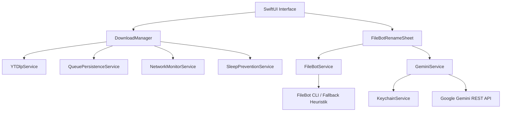

# Mac Video Loader (MVL) – Entwickler- & Anwender-Dokumentation

> [!INFO] Überblick
> **Mac Video Loader (MVL)** ist eine native macOS-Anwendung in Swift und SwiftUI für macOS 13+ (Ventura, Sonoma, Sequoia). Sie vereint den Ausfall-gesicherten Download von Videos und Tonspuren aus öffentlich-rechtlichen Mediatheken (ARD, ZDF, Arte, 3sat, etc.), YouTube und beliebigen Webseiten mit einem intelligenten **FileBot Rename Studio** und nativer **Google Gemini KI-Unterstützung**.

---

## Inhaltsverzeichnis
- [[#1. Architektur & Kernmodule]]
- [[#2. FileBot Rename Studio]]
- [[#3. Google Gemini KI-Integration]]
- [[#4. Downloads & Mediatheken]]
- [[#5. Datenschutz & Sicherheit]]
- [[#6. Build-, Installations- & Release-Pipeline]]

---

## 1. Architektur & Kernmodule



### Komponenten-Übersicht

| Modul | Datei | Aufgabe |
| :--- | :--- | :--- |
| `DownloadManager` | `Services/DownloadManager.swift` | Zentrale Steuerung der Warteschlange, Multi-Threading, Persistenz & Playlist-Inspektion. |
| `FileBotService` | `Services/FileBotService.swift` | Anbindung von FileBot CLI, rekursive Ordnerscans & lokale Heuristik für Serien/Dateien. |
| `GeminiService` | `Services/GeminiService.swift` | REST-Client für Google Gemini 2.5 Flash / Pro mit strukturiertem JSON-Output. |
| `KeychainService` | `Services/KeychainService.swift` | Sichere Speicherung sensibler Tokens im macOS-Schlüsselbund. |
| `YTDlpService` | `Services/YTDlpService.swift` | Subprozess-Wrapper für `yt-dlp` und `ffmpeg` mit Watchdog-Schutz. |
| `FileBotRenameSheet` | `Views/FileBotRenameSheet.swift` | Dual-Pane Vorschauoberfläche mit Echtzeit-Filtern, Tokens und KI-Prompt. |

---

## 2. FileBot Rename Studio

Das **Rename Studio** kann wahlweise direkt im Anschluss an einen Download oder als eigenständiges Werkzeug für bestehende Ordner geöffnet werden.

> [!TIP] Ordner-Auswahl & Rekursives Scannen
> Über die Top-Navigation (`Dateien umbenennen...`) oder per Drag & Drop eines Finders-Ordners wird der Ordner rekursiv inklusive aller Unterordner durchsucht (`FileBotService.scanFolderRecursively`).

### Die drei Verarbeitungsmodi

1. **Serienverarbeitung (`.series`)**:
   - Benennt Episoden nach einheitlichem Namensschema um.
   - Standard: `{n} - {s00e00} - {t}` (z. B. `Breaking Bad - S01E01 - Der Einstieg.mp4`).
2. **Staffelverarbeitung (`.season`)**:
   - Organisiert Episoden in sauber hierarchischen Staffel-Verzeichnissen für Plex/Jellyfin.
   - Standard: `{n}/Staffel {s.pad(2)}/{n} - {s00e00} - {t}`.
3. **Dateien & Markup (`.custom`)**:
   - Beliebige Dateien (Dokumente, Fotos, Audio, Backups) mit Tokens oder freitextlichen KI-Prompts umbenennen.
   - Standard: `{folder} - {index.pad(2)} - {original}`.

### Verfügbare Markup-Tokens

- `{original}` / `{fn}`: Ursprünglicher Dateiname ohne Endung
- `{folder}`: Name des übergeordneten Ordners
- `{date}`: Dateidatum im Format `YYYY-MM-DD` (`{year}`, `{month}`, `{day}`)
- `{index}` / `{index.pad(2)}` / `{index.pad(3)}`: Fortlaufende Nummerierung (`01`, `02`, `001`...)
- `{clean}`: Bereinigt Punkte, Unterstriche und doppelte Leerzeichen
- `{lower}` / `{upper}`: Groß- und Kleinschreibung
- `{ext}`: Original-Dateiendung

---

## 3. Google Gemini KI-Integration

> [!NOTE] Modell-Wahl & Geschwindigkeit
> Standardmäßig ist **Gemini 2.5 Flash** aktiviert. Es liefert Metadaten-Vorschläge in unter einer Sekunde bei minimalem Token-Verbrauch. Für anspruchsvolle Titel kann jederzeit auf **Gemini 2.5 Pro** gewechselt werden.

### Funktionsweise
1. **Plex-Optimierung**:
   - Gemini gleicht Folgentitel mit globalem Serienwissen (TMDb / TheTVDB) ab.
   - **Echte Episodennummern**: Folgen werden nach ihrem tatsächlichen Inhalt nummeriert – ein Titel mit „A“ wird nicht blind zu Folge 1 gemacht.
   - Jede Folge in einer Staffel erhält eine individuelle, aufsteigende Nummer (`s01e01`, `s01e02`...).
2. **Prompt-Eingabefeld (`aiPromptText`)**:
   - Über das KI-Prompt-Feld können individuelle Regie-Anweisungen mitgegeben werden (z. B. *„Staffel 2, nummeriere ab Folge 9“* oder *„Rechnungen nach 'YYYY-MM-DD - Firma - Rechnung' formatieren“*).
3. **Expliziter Abgleich**:
   - Der Abgleich startet nicht automatisch im Hintergrund, sondern erst nach Klick auf den Button **`Abgleichen`** oder Drücken der Enter-Taste.

---

## 4. Downloads & Mediatheken

- **Mediatheken-Auto-Staffelerkennung**:
  - Wird eine einzelne Folge aus ARD oder ZDF eingefügt, findet MVL automatisch die komplette Staffel (bis zu 500 Episoden).
- **Format-Priorisierung**:
  - Direkte progressive MP4-Streams (`http...`) werden HLS-MPEG-TS vorgezogen, was Konvertierungszeiten um bis zu 80 % reduziert.
- **FFmpeg Watchdog**:
  - Ein 60-Sekunden-Watchdog überwacht Post-Processing-Vorgänge und setzt hängende Streams automatisch mit `--continue` fort.
- **Getrennte Queue-Abschnitte**:
  - Erfolgreich beendete und fehlerhafte Downloads sammeln sich am Ende der Liste in eigenen, ein- und ausklappbaren Bereichen.

---

## 5. Datenschutz & Sicherheit

> [!SECURITY] Zero-Leakage & Lokale Verschlüsselung
> - **macOS Keychain**: API-Keys werden ausschließlich verschlüsselt in der Apple Keychain abgelegt (`kSecClassGenericPassword`, Service: `com.macvideoloader.gemini`).
> - **Keine Telemetrie / Tracking**: MVL sendet keinerlei Nutzungsdaten an Drittanbieter.
> - **Browser-Cookies**: Passwörter verbleiben im Browser. Bei TCC-Zugriffsbeschränkungen schaltet die App nahtlos auf Fallbacks um.
> - **Datenschutzkonformer Code**: Keine Hardcoded Tokens, Pfade oder Nutzer-Identifikatoren im Repository.

---

## 6. Build-, Installations- & Release-Pipeline

### Lokale Befehle

```bash
# 1. Debug-Build ausführen
swift build

# 2. Release-Bundle bauen und Retina-Icons generieren
./bundle_app.sh

# 3. Direkt in /Applications installieren
./install.sh

# 4. Portables Disk-Image (DMG) erstellen
./create_dmg.sh

# 5. Vollständiges GitHub-Release veröffentlichen
./deploy_release.sh
```

### Release-Informationen

- **Repository**: `github.com/mrgoldsmitt/Mac-Video-Loader`
- **Aktuelle Version**: `v0.7.0`
- **Lizenz**: [Creative Commons Namensnennung - Nicht-kommerziell 4.0 (CC BY-NC 4.0)](https://creativecommons.org/licenses/by-nc/4.0/deed.de)
- **Copyright**: (c) 2026 `mrgoldsmitt`
